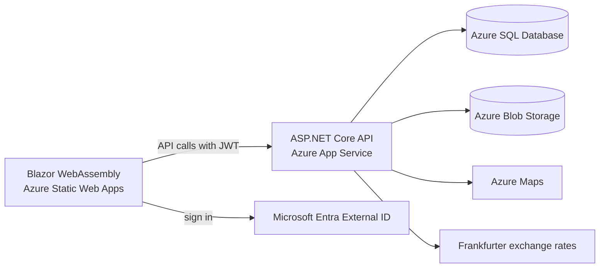

# TravelPlan

A travel planning and memory app. Plan a trip on a calendar that zooms from a
year down to a single day, track the budget in any currency, share the trip
with the people you travel with, and keep an automatically generated summary
of it when it ends.

Built with .NET 10 (ASP.NET Core and Blazor WebAssembly) and deployed on
Azure.

Live demo: (add link)

---

## Features

- Trips as projects on a calendar that zooms from year to month, week and day
- Plan items that move between an ideas backlog, a day, and a time slot by
  drag and drop
- A live countdown to the next trip or the next stop
- Budget by category. The API can convert between currencies using exchange
  rates cached daily from the Frankfurter API, but the web app doesn't call
  that endpoint yet — budget totals shown in the app are not converted
- Stays and transport legs, with static map thumbnails from Azure Maps
- Sharing: invite people as Editor or Viewer, or share an anonymous link
- Reports: an itinerary at any time, and a memory summary generated when the
  trip ends, as PNG, PDF or a web page
- Photos attached to plan items, with thumbnails
- Sign-in with email or Google through Microsoft Entra External ID
- A diary-style interface with page-turn transitions

Planned: a .NET MAUI mobile app, phone-number sign-up, and quick capture of a
plan item from a pasted link.

---

## Architecture



- The front end is static files served by Azure Static Web Apps. It runs in
  the browser and signs users in with MSAL.
- The API validates the token on every request, checks the user's access to
  the trip, and is the only component that talks to the database, storage
  and external services. Secrets stay on the server.
- A shared class library holds the DTOs, models and validation rules used by
  both the API and the front end.

---

## Tech stack

- C# and .NET 10
- ASP.NET Core Web API, Entity Framework Core
- Blazor WebAssembly
- SQLite for local development, Azure SQL Database in production
- Microsoft Entra External ID (email and Google sign-in), JWT bearer auth
- Azure App Service, Azure Static Web Apps, Azure Blob Storage, Azure Maps
- SkiaSharp for images, PDFs and thumbnails
- xUnit, GitHub Actions

---

## Engineering notes

- **One access check.** A single service decides whether a request has
  Viewer, Editor or Owner access to a trip, for named collaborators and
  anonymous share links alike. Every endpoint goes through it.
- **Race-free trip completion.** Completing a trip generates a report, and it
  can be triggered from several places. An atomic conditional update in the
  database ensures only one trigger wins, so only one report is ever
  generated.
- **One rendering pipeline.** A report is drawn once with SkiaSharp and output
  as both PNG and PDF. A Razor template renders the same data as HTML.
- **Two database providers.** SQLite locally and Azure SQL in production, with
  a separate migration history for each, because each provider needs its own
  column types. CI applies both, including against a real SQL Server.
- **Cost-aware hosting.** The database runs on Azure's free serverless offer
  and pauses when idle. Background jobs run daily and the UI does not poll,
  so the database can actually stay paused.

---

## Project structure

```
TravelPlan.Shared/     DTOs, models and validators shared by API and Web
TravelPlan.Api/        REST API, EF Core, background services, reports, photos
TravelPlan.Web/        Blazor WebAssembly front end
TravelPlan.Tests/      xUnit tests (SQLite-backed)
scripts/deploy-api.sh  API deployment script
.github/workflows/     CI and Static Web Apps deployment
```

---

## Running locally

Prerequisites:

- .NET 10 SDK
- Optional: an Azure Storage account (for photos) and an Azure Maps key (for
  map thumbnails). Without them those two features alone are unavailable.

Sign-in uses the same real Microsoft Entra External ID tenant as production —
there is no development bypass — but no setup is needed for it: the API and
web app registrations' settings are already checked into `appsettings.json`
and `wwwroot/appsettings.json`, and the local redirect URI
(`https://localhost:7156/authentication/login-callback`) is already
registered on the web app registration.

Steps:

1. Clone the repository.
2. Trust the development certificate: `dotnet dev-certs https --trust`
3. Start the API:
   `cd TravelPlan.Api && dotnet run --launch-profile https`
   (https://localhost:7277, Swagger at /swagger, health check at /health)
4. Start the web app:
   `cd TravelPlan.Web && dotnet run --launch-profile https`
   (https://localhost:7156)

Locally the API uses SQLite. The database file is created and migrated
automatically.

---

## Tests

```
cd TravelPlan.Tests
dotnet test
```

The tests run against SQLite rather than EF Core's in-memory provider, so
database behaviour such as comparisons and constraints is actually exercised.
CI also applies the migrations for both SQLite and SQL Server.

---

## Configuration

API settings (user-secrets locally, App Service settings in production):

- `DatabaseProvider` and `ConnectionStrings:DefaultConnection` — production
  only; left unset locally, where SQLite is used automatically
- `AzureAd:Instance`, `AzureAd:TenantId`, `AzureAd:ClientId` — already
  checked into `appsettings.json`; there's no client secret to protect, since
  this is just the API validating incoming tokens
- `AzureStorage:ConnectionString` and `AzureStorage:ContainerName` — optional
  locally; required for photos
- `AzureMaps:SubscriptionKey` — optional locally; required for map thumbnails
- `ExchangeRateApi:BaseUrl`
- `CompletionSweepIntervalMinutes`, `ExchangeRateRefreshIntervalMinutes`

Web settings (`TravelPlan.Web/wwwroot/appsettings.json`):

- `ApiBaseUrl`
- `AzureAd:Authority`, `AzureAd:ClientId`
- `ApiScope` — a top-level setting, not nested under `AzureAd`

---

## Deployment

- The web app deploys automatically from GitHub through the Azure Static Web
  Apps workflow.
- The API deploys with `scripts/deploy-api.sh`, which publishes for Linux and
  starts the App Service if it is stopped.
- Database migrations are applied by the API after startup, with retry while
  a paused database resumes.

---

## How it was built

Developed with Claude Code as an AI pair programmer. Work was split into
scoped sessions driven by design documents, and changes were accepted only
with evidence: tests that fail when the original bug is reintroduced, CI
against both database providers, and live verification.
